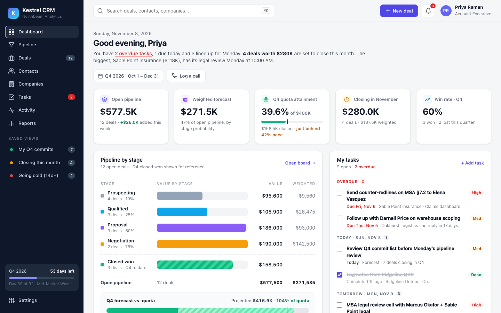
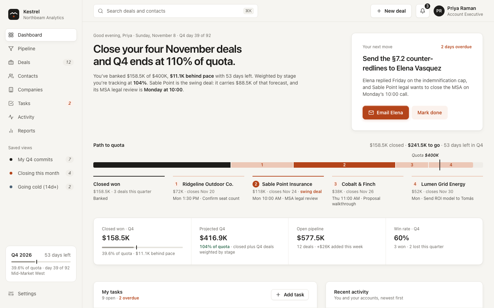
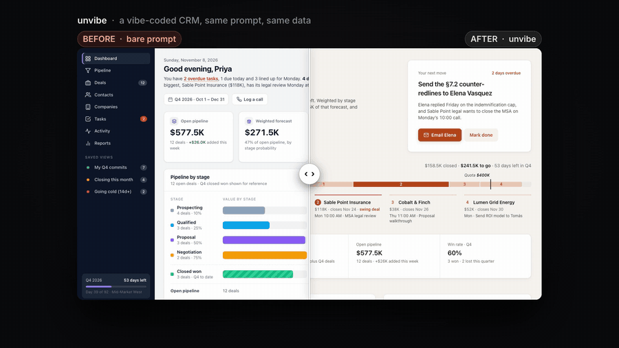

# unvibe

Take the vibe-coded look out of an app. A [Claude Code](https://claude.com/claude-code) skill that makes apps and web apps look premium and keep users, distilled from all 81 videos on [Tim Gabe's YouTube channel](https://www.youtube.com/@TimGabe) (ex-Spotify designer, now running a product-design agency for app founders). Two modes:

- **Audit**: score an existing screen, flow, onboarding, landing page or paywall and list the fixes in impact order.
- **Build**: design a new one by the recipe. Direction first, every state designed, his exact type, spacing and colour numbers, emotion only at the peak and the end, structure before price.

## Before and after

The same prompt built a CRM dashboard twice in a clean folder with headless Claude Code, no project context and no memory. Left: the bare prompt. Right: the bare prompt's output handed to the skill with the words "make this dashboard better".

| Before · bare prompt | After · unvibe |
|---|---|
|  |  |



Measured on the two HTML files with `scripts/measure_html.py`, not eyeballed:

| | Bare prompt | After the skill |
|---|---|---|
| Font sizes in use | 13 | 4 |
| Font weights | 6 | 2 |
| Hex colours | 69 | 20 |
| Buttons and links that go nowhere | 27 | 0 |
| Empty, loading, error or stale states designed | 0 | 6 |
| Headline | "Good evening, Priya" | "Close your four November deals and Q4 ends at 110% of quota." |
| Primary action | none; "New deal" and "Log a call" compete | one filled button on the overdue next move |

The skill scored the original 2 of 5 on point of view and, by its own rule, chose a new direction ("your number, and the next move that gets you there") instead of polishing. On an input that already has a direction (3 of 5 or more) it keeps the look and fixes states, dead ends and the ending, which is correct and far less visible in a screenshot.

A 14-second video of the slider is in [docs/demo-slider.mp4](docs/demo-slider.mp4).

## Install

User-level, available in every project:

```bash
git clone https://github.com/saurabhyadavz/unvibe.git ~/.claude/skills/unvibe
```

Or inside one project:

```bash
git clone https://github.com/saurabhyadavz/unvibe.git .claude/skills/unvibe
```

Then ask Claude Code in plain words. The skill fires on things like "this screen feels off", "our free users never upgrade", "design the paywall", "audit this dashboard", "make this landing page feel like a real company made it". You can also invoke it directly with `/unvibe`.

## What is inside

```
SKILL.md                 the workflow: which mode, the audit layers, the build order, the numbers
references/
  direction.md           point of view, the scorecard, the hidden assumption, designing with AI
  ux-foundation.md       flows, every state, onboarding, trust in money and health products, data screens
  visual-rules.md        type, spacing, grid, colour, assets, buttons, landing anatomy, design systems
  emotion-motion.md      peak-end, gift not receipt, springs, where to spend delight
  retention.md           routine cue, forgiveness, the clock, gamification that works, identity
  paywalls.md            structure before price, honest paywalls, timing, framing, test velocity
  sources.md             every rule mapped to the video it came from
scripts/measure_html.py  counts sizes, weights, colours, gradients, dead links, off-grid spacing and
                         states in an HTML file; two files give a before/after table
evals/                   test cases in the `claude plugin eval` layout (prompt, expected outcome, graders)
docs/                    the images and demo above
```

Claude reads `SKILL.md` when the skill fires and only the one or two reference files the task touches. Every rule carries the id of the video it came from, so a claim can be checked against the source.

## The recipe in one paragraph

Decide what premium means to this buyer and the one idea every screen will honour, before any pixel. Make sure the user always knows what just happened, can undo it, and knows what to do next, in every state including the ones you hope nobody sees. Apply a small set of numbers to the surface: one font (two at most), four sizes and two weights, the 8-point grid, related things at the base gap and the next group at twice it, 60/30/10 colour with the brand colour reserved for the one thing that must pop, one call to action, copy that sells the outcome. Spend emotion only at the peak and the end, and deliver results as gifts, not receipts. Keep people with a routine cue and forgiveness, a clock in the hero feature, local winnable competition, stakes on screen, and identity they can show. Fix the paywall's structure before arguing about its price.

## How it was validated

- Three test cases, each run with and without the skill: audit a real app home screen, write a paywall spec, rewrite a generic landing hero. Pass rate on 20 verifiable checks: 90% with the skill, 80% without, one run each, so indicative rather than statistical. The skill's lift was in undesigned states, the number of options on a first paywall screen, and the timing of the ask; both configurations already handled the surface rules.
- The CRM test above, run in a clean folder with `claude -p`, skills disabled for the baseline, so nothing from any project leaked into either run.
- A critic pass on the demo video caught a render bug and unreadable phone-size text before publishing.

Honest caveats: the skill's improve runs cost more than a bare build (about twice the tokens and time on the CRM test, mostly reading references and rendering checks). One eval case is not in this repo because its input is a private product's source code.

## Credits

Every design idea here is Tim Gabe's, from his channel [@TimGabe](https://www.youtube.com/@TimGabe); `references/sources.md` lists all 81 videos with what each contributed. This is an independent distillation and is not affiliated with or endorsed by him. If you build apps, watch the videos; the skill is a reminder of them, not a replacement.

The shape of the audit borrows from two unslop projects: [Damir Sokolovsky's unslop skill](https://heydamir.design/unslop) (CC BY 4.0) for the tells-with-fixes list, the banned direction words, the fixed pass order and the rule to leave a good screen alone; and [Matt Shumer's unslop](https://github.com/mshumer/unslop) (MIT) for measuring a model's defaults instead of guessing at them. The wording in this repo is its own.

Built with Claude Code. The demo video's music was generated with Google Lyria.

## License

MIT, see [LICENSE](LICENSE). The license covers the text of this repository; the underlying ideas remain their author's.
